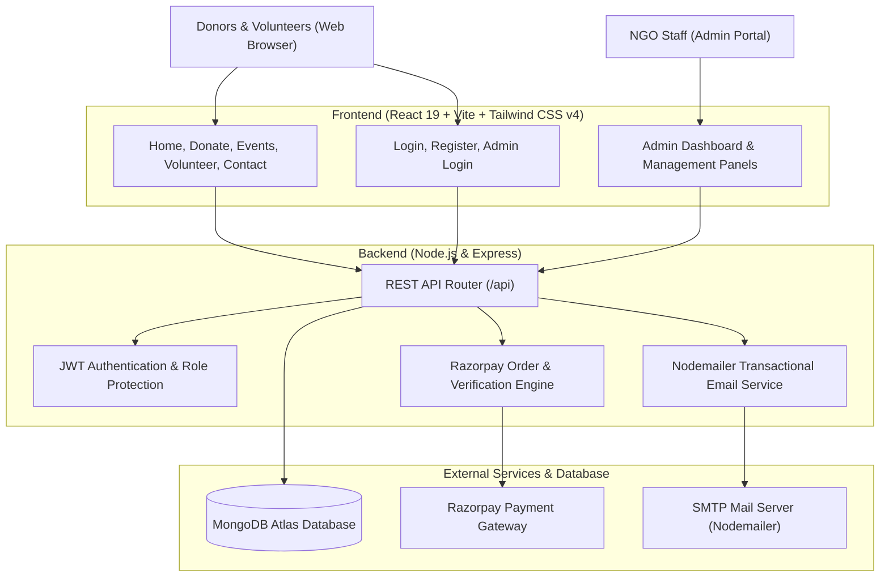

# NGOConnect

[](LICENSE)
[](https://react.dev/)
[](https://vitejs.dev/)
[](https://tailwindcss.com/)
[](https://nodejs.org/)
[](https://expressjs.com/)
[](https://www.mongodb.com/)
[](https://razorpay.com/)
[](https://ngo-platform-r52v.onrender.com)

> **A full-stack charity and NGO management platform connecting donors, volunteers, and causes with secure Razorpay donations, real-time campaign tracking, automated notifications, and an administrative control center.**

[Live Application](https://ngo-platform-r52v.onrender.com) • [Key Features](#key-features) • [Getting Started](#getting-started) • [Tech Stack](#tech-stack) • [Contributing](CONTRIBUTING.md)

---

## Table of Contents

- [Overview](#overview)
- [Key Features](#key-features)
- [Platform Architecture](#platform-architecture)
- [Directory Structure](#directory-structure)
- [Tech Stack](#tech-stack)
- [Getting Started](#getting-started)
- [Environment Variables](#environment-variables)
- [API Endpoints](#api-endpoints)
- [Database Models](#database-models)
- [Contributing](#contributing)
- [License](#license)

---

## Overview

Non-governmental organizations frequently face fragmentation across donation processing, volunteer coordination, and public awareness. **NGOConnect** provides an all-in-one platform engineered to unite donors, volunteers, and administrators under one transparent ecosystem.

Donors can make instant monetary contributions via Razorpay or schedule donation drives for clothes, food, and books. Volunteers can sign up for causes matching their skillset, while administrators gain complete visibility through a unified dashboard.

---

## Key Features

### Donors and Public
- **Monetary Donations**: Secure online payment processing powered by Razorpay with instant verification and confirmation.
- **In-Kind Drives**: Support campaigns by donating physical items (clothes, books, food packages).
- **Child Welfare & Education Sponsorship**: Dedicated initiatives for sponsoring underprivileged children's schooling and healthcare.
- **Event Participation**: Browse upcoming charity drives, awareness walks, and community workshops.
- **Automated Confirmations**: Automated thank-you receipts sent via Nodemailer.
- **Donor Portal**: Personal dashboard to review past contributions and donation status.

### Volunteers
- **Volunteer Registration**: Easy onboarding for individuals and groups wanting to offer their time and skills.
- **Role Assignment**: Opportunities categorized by field (teaching, medical assistance, food distribution, event logistics).
- **Volunteer Portal**: View assignments, team updates, and active campaigns.

### Admin Dashboard
- **Real-Time Analytics**: Visual overview of total funds raised, donation trends, and active volunteers.
- **Donation Management**: Search, filter, and verify transactions and offline pledges.
- **Volunteer Management**: Review applications, approve candidates, and assign roles.
- **Event Scheduling**: Create, edit, and publish community charity events.
- **Inquiries and Support**: Direct inbox for managing questions submitted by visitors.

---

## Platform Architecture



---

## Directory Structure

```text
NGO/
├── backend/
│   ├── models/                # Mongoose database schemas
│   │   ├── Contact.js         # Visitor inquiries
│   │   ├── Donation.js        # Monetary and physical donations
│   │   ├── Event.js           # Charity events and campaigns
│   │   ├── User.js            # User accounts, auth & roles
│   │   └── Volunteer.js       # Volunteer applications and records
│   ├── server/
│   │   ├── index.js           # Express app, routes, middleware, and auto-seeding
│   │   └── .env               # Backend environment variables
│   └── package.json           # Backend dependencies and scripts
│
├── frontend/
│   ├── public/                # Static assets, logos, and icons
│   ├── src/
│   │   ├── admin/             # Admin portal components (Dashboard, Donations, Volunteers, Events)
│   │   ├── context/           # React context for state and auth
│   │   ├── layouts/           # Page layouts and navigational shells
│   │   ├── pages/             # Public views (Home, Donate, Volunteer, Events, Contact, Login)
│   │   ├── api.js             # API client utilities
│   │   ├── App.jsx            # Main route declarations
│   │   └── main.jsx           # Application entry point
│   ├── index.html
│   ├── vite.config.js         # Vite 7 build configuration
│   └── package.json           # Frontend dependencies and scripts
│
├── render.yaml                # Render cloud deployment blueprint
├── SETUP.md                   # Quick setup guide
└── README.md
```

---

## Tech Stack

| Layer | Technologies |
| :--- | :--- |
| **Frontend** | [React 19](https://react.dev/), [Vite 7](https://vitejs.dev/), [Tailwind CSS v4](https://tailwindcss.com/), [React Router 7](https://reactrouter.com/), [React Icons](https://react-icons.github.io/react-icons/) |
| **Backend** | [Node.js](https://nodejs.org/), [Express 4](https://expressjs.com/), [Mongoose 7](https://mongoosejs.com/) |
| **Database** | [MongoDB Atlas](https://www.mongodb.com/atlas) |
| **Payments** | [Razorpay API](https://razorpay.com/) (Orders, Signatures, Verification) |
| **Auth & Security** | [JWT](https://jwt.io/) (JSON Web Tokens), [bcryptjs](https://github.com/dcodeIO/bcrypt.js) |
| **Communications** | [Nodemailer](https://nodemailer.com/) (Automated transactional emails) |
| **Deployment** | [Render](https://render.com/) |

---

## Getting Started

### Prerequisites
- [Node.js](https://nodejs.org/) `>= 18.0.0`
- [npm](https://www.npmjs.com/) or [yarn](https://yarnpkg.com/)
- A [MongoDB Atlas](https://www.mongodb.com/) cluster or a local MongoDB database
- *(Optional)* [Razorpay](https://dashboard.razorpay.com/) test credentials for payment testing

---

### Installation & Setup

#### 1. Clone the repository
```bash
git clone https://github.com/Mohitgharate10/NGO.git
cd NGO
```

#### 2. Configure Backend
Navigate to the backend directory:
```bash
cd backend
npm install
```

Create a `.env` file in `backend/server/.env` (or `backend/.env`):
```env
PORT=5000
MONGO_URI=mongodb+srv://<username>:<password>@<cluster>.mongodb.net/ngoconnect?retryWrites=true&w=majority
JWT_SECRET=your_jwt_super_secret_key
RAZORPAY_KEY_ID=rzp_test_your_key_id
RAZORPAY_KEY_SECRET=your_razorpay_secret
EMAIL_USER=your_email@gmail.com
EMAIL_PASS=your_gmail_app_password
```

Start the backend server:
```bash
npm run dev
# or for production:
npm start
```

> **Default Admin Account**: On initial database connection, an admin account is seeded automatically:  
> **Email**: `admin@smilefoundation.org` | **Password**: `Admin@123`

#### 3. Configure Frontend
Open a new terminal window:
```bash
cd frontend
npm install
```

Create a `.env` file in `frontend/.env` (optional, defaults to local port):
```env
VITE_API_URL=http://localhost:5000/api
```

Start the Vite development server:
```bash
npm run dev
```

Visit [http://localhost:5173](http://localhost:5173) in your browser.

---

## API Endpoints

| Method | Endpoint | Description | Access |
| :--- | :--- | :--- | :--- |
| `POST` | `/api/auth/register` | Register donor or volunteer account | Public |
| `POST` | `/api/auth/login` | Login user and obtain JWT | Public |
| `POST` | `/api/auth/admin-login` | Admin portal authentication | Public |
| `POST` | `/api/donations/create-order` | Create Razorpay order | Authenticated |
| `POST` | `/api/donations/verify` | Verify payment signature and record donation | Authenticated |
| `GET` | `/api/donations` | Fetch all donations (with filters) | Admin / Authenticated |
| `POST` | `/api/volunteer/apply` | Submit volunteer application | Public |
| `GET` | `/api/volunteer/all` | Fetch volunteer applications | Admin |
| `GET` | `/api/events` | List all charity events | Public |
| `POST` | `/api/events` | Create a new charity event | Admin |
| `POST` | `/api/contact` | Submit contact / support inquiry | Public |
| `GET` | `/api/admin/stats` | Aggregate dashboard statistics | Admin |

---

## Database Models

| Model | Key Fields | Description |
| :--- | :--- | :--- |
| **User** | `name`, `email`, `password`, `role` (`donor`, `volunteer`, `admin`), `phone` | Accounts and credentials |
| **Donation** | `donorName`, `email`, `phone`, `amount`, `paymentId`, `status`, `donationType` | Transaction and item donations |
| **Volunteer** | `name`, `email`, `phone`, `skills`, `availability`, `status` (`pending`, `approved`) | Volunteer applications |
| **Event** | `eventName`, `description`, `date`, `location`, `targetAmount`, `image` | Charity drives and awareness events |
| **Contact** | `name`, `email`, `subject`, `message`, `createdAt` | General inquiries |

---

## Contributing

Contributions are welcome. Check out the [Contributing Guidelines](CONTRIBUTING.md) to get started with bug fixes, features, or design suggestions.

---

## License

This project is licensed under the **MIT License**.

---

<p align="center">
  Maintained by <a href="https://github.com/Mohitgharate10">Mohit Gharate</a>
</p>
